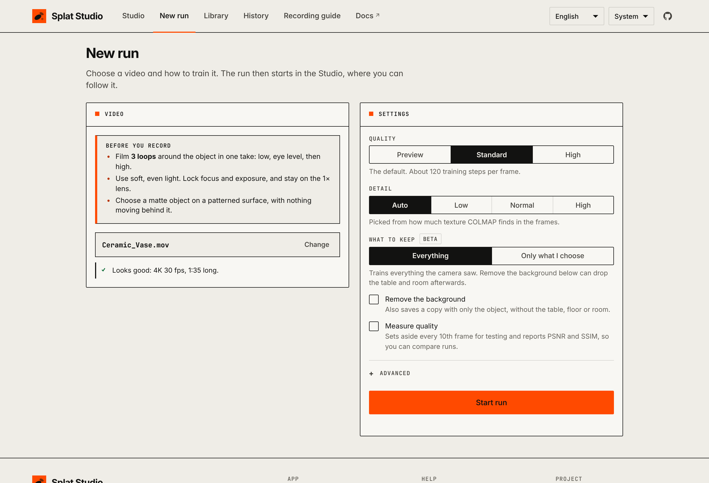
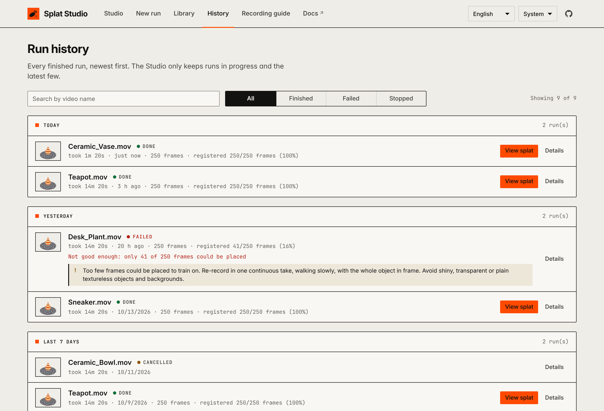
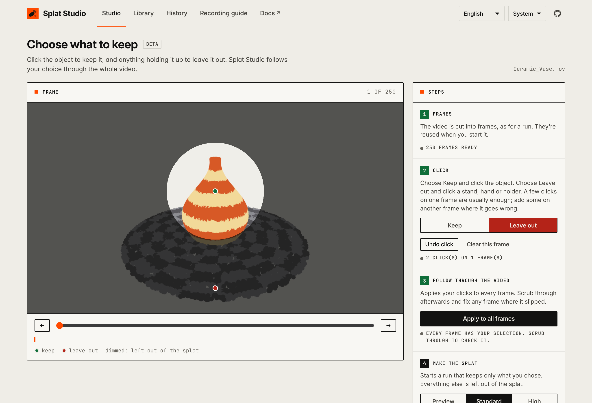

# Splat Studio

**Turn a phone video into a 3D Gaussian splat on your own Mac, then put it on a website.**

*English · [Português](#português)* — the app itself switches between English and Portuguese.

Film an object by walking around it, drop the video into Splat Studio, and get a 3D model
you can orbit, zoom and share. Everything runs locally: no uploads, no accounts, no cloud GPU.


It wires together three open-source tools and handles the fiddly parts for you:

| Step | Tool | What Splat Studio adds |
|---|---|---|
| Video → frames | ffmpeg | even sampling, iPhone HDR conversion, blurry-frame filtering |
| Frames → camera poses | [COLMAP](https://colmap.github.io/) | retries automatically when tracking breaks, time estimates, one folder per run |
| Poses → splat | [Brush](https://github.com/ArthurBrussee/brush) | settings chosen from your footage, built automatically on first use |
| Splat → website | [Spark](https://sparkjs.dev) + three.js | viewer with auto-upright, one-click export of a self-contained site |

## Contents

- [Requirements](#requirements)
- [Install](#install)
- [Quick start](#quick-start)
- [Recording a good video](#recording-a-good-video)
- [Using the app](#using-the-app)
- [Command line](#command-line)
- [Removing background fog](#removing-background-fog)
- [Removing the background](#removing-the-background)
- [Choosing what to keep (beta)](#choosing-what-to-keep-beta)
- [Comparing two splats](#comparing-two-splats)
- [Putting a splat on your website](#putting-a-splat-on-your-website)
- [Troubleshooting](#troubleshooting)
- [Development](#development)

## Requirements

- A Mac with Apple Silicon (M1 or newer) is the main target: Brush trains on its GPU through Metal.
  Linux with an NVIDIA GPU should also work, but you install the tools yourself.
- Python 3.9 or newer (the one that comes with macOS is fine).
- About 5 GB of free disk space for the tools, plus room for your videos.

Everything else (Homebrew, ffmpeg, COLMAP, Rust, Brush) is installed by `./splat-studio setup`.

## Install

```bash
git clone https://github.com/gpspelle/splat-studio.git
cd splat-studio
./splat-studio setup
```

Or download a stable version from [Releases](https://github.com/gpspelle/splat-studio/releases/latest)
(the latest is v0.4.0), unzip it, and run `./splat-studio setup` inside.

`setup` checks what's missing and installs it. It may open a macOS window to install the
Xcode command-line tools, and ask for your Mac password to install Homebrew. Then it downloads
and builds Brush, which takes 10–30 minutes, once. Run `./splat-studio check` at any time to
see what's installed.

> Prefer `pip`? `pip install .` gives you a `splat-studio` command. The `./splat-studio`
> script does the same without installing anything.

## Quick start

```bash
./splat-studio
```

Your browser opens Splat Studio at <http://localhost:8765>. Then:

1. Read the **Recording guide** (in the menu at the top) and film your object.
2. Click **New run** and drop the video there. Splat Studio checks it and warns you about anything likely to fail.
3. Pick the settings and click **Start run**. You're taken back to the **Studio**, where you
   watch the progress: frames → camera poses → training.
4. Click **View splat** to look at the result, and **Export website** to publish it.

Your videos and results are kept in `~/SplatStudio` (change it with `--data-dir`).

## Recording a good video

The quality of the video decides almost everything. In short:

- **One continuous take, three loops** around the object: low, eye level, high. Walk slowly,
  1½–4 minutes in total.
- **Soft, even light.** Lock focus and exposure (press and hold on the object). Stay on the
  1× lens and never zoom.
- **A matte object on a textured surface**, with nothing moving in the scene. Avoid glass,
  chrome, plain white tables and turntables.
- **Keep a steady distance from the object's surface**: around a car, walk a rounded rectangle,
  not a circle. The guide has sections for [cars and large objects](docs/capture-guide.md#7-cars-and-other-large-objects)
  and for [people](docs/capture-guide.md#8-people).


The full guide is in the app and in **[docs/capture-guide.md](docs/capture-guide.md)**.

Splat Studio helps you get it right with fewer attempts:

- **Before processing**, it checks each upload's length, resolution, frame rate, HDR and
  orientation, and tells you what to fix.
- **Right after the camera poses**, before training, it checks where the cameras were around
  the object. A **coverage ring** on the run (seen from above, one dot per camera) shows any side
  you skipped in red. A gap over 60°, or cameras all at one height, gives a warning that names
  the moment in the video. **A side nobody filmed stops the run before training** (unless you
  tick *Train even if a side wasn't filmed*), so you can film it again instead of waiting for a
  thin, blurry model; the run keeps its camera poses and **Train anyway** trains them with the same
  settings. Only a missing side stops a run: one height is a warning, and the bottom of something
  standing on a surface (under a car, under a vase) never counts as missing. Neither does a side
  **nobody could film**: when COLMAP's 3D points show something standing there (the object is
  against a wall, in a corner, next to another car), that side is drawn dashed grey on the ring
  and grey on the viewer's globe, with a note instead of a warning. The object itself never
  counts as something in the way, however long it is (a car's bumper), and the distance
  you stood is judged per direction, so a rounded-rectangle walk around a car is fine.
  `./splat-studio coverage workspace/<video>/latest` prints the same numbers. With several objects,
  each object gets its own ring, measured around that object and counting only the frames where
  it's visible, so a side hidden behind another object shows up too.
- **After a run**, if tracking broke, it tells you **at which seconds of the video** it
  happened, so you know exactly which part to re-film.
- It flags blurry footage, and runs that couldn't be reconstructed, with concrete advice.

<br clear="right">

## Using the app

The app has two main pages. The **Studio** (`/`) shows your runs and your splat library.
**New run** (`/new`) is where you choose a video and its settings: quality, detail, what to
keep, and the options. Starting a run takes you back to the Studio to follow it.

To process several videos, drop or pick them all on **New run**. Each one is listed with its
checks (remove any with **Remove**). **Start N runs** queues one run per video with the same
settings, run one after another. With several videos, everything the camera saw is trained;
to choose what to keep, start them one at a time. **Save these settings as defaults** makes
New run start from the current settings next time.



### Runs


Each run shows its stage, the current step, and the time left. Estimates get accurate after
the first run on your Mac, because measured speeds are remembered. Runs are queued and
processed one at a time. **Details** shows each COLMAP attempt, where tracking broke, the Brush
settings used, and the full log.

Once a run finishes it shrinks to one line: its name, the result and **View splat**. Problems
stay on that line (the error, and any advice about what to film again); **Details** opens the
steps, the other versions, **Train again** and the log. The Studio keeps runs in progress plus
the finished runs from the last day (at least the latest 3, at most 5). Everything older is on
the **History** page.

**Train again** re-trains a finished run with other settings, reusing its camera poses (no
COLMAP). Every splat is kept, so you can compare.

### History



**History** (in the header, or **All runs** under the run list) lists every finished run,
newest first, grouped into Today, Yesterday, Last 7 days and then by month. Search by video
name, or show only finished, failed or stopped runs. **Remove from list** (under **Details**)
deletes the run's record and log only: its splats and run folder stay in the library.

### Look and feel

The app follows your computer's light or dark setting; the **Theme** menu at the top right
overrides it. The design system (colours, type, components, accessibility rules) is described
in [docs/design-system.md](docs/design-system.md).

### Language

Use the language menu at the top right to switch between **English** and **Português**. The
choice is remembered in your browser; the first time, it follows your browser's language.

### Settings

| Setting | Options | Notes |
|---|---|---|
| Quality | Preview · Standard · High | Preview is ~4× faster, good for checking a capture. High takes longer and gives finer detail. |
| Detail | Auto · Low · Normal · High | Auto judges it from how much texture the footage has. |
| Remove the background | on/off (off) | Also saves a copy with only the object: no table, floor or room. The original is always kept. |
| Train even if a side wasn't filmed | on/off (off) | Off: a run whose camera positions show a side nobody filmed stops before training, with **Train anyway** to continue. On: it trains anyway and only warns. In the terminal: `run --stop-on-gaps`. |
| Measure quality | on/off | Holds back every 10th frame and reports PSNR/SSIM, so runs can be compared with a number. |
| Advanced | frames, trim start/end, extra Brush options | e.g. trim the first seconds while you were pressing record. |

### Viewer


Drag to orbit, scroll to zoom, right-drag to pan. The model is stood upright automatically,
using the "up" direction Brush saves in the file, and the camera is framed on the object. If
it's still tilted, use **Flip**, **Tilt** or **Roll**. **Crop** hides everything outside a
sphere around the object (drag the slider to resize it). **Save view** remembers orientation
and crop, and both are included when you export a website. You can also import any `.ply`, `.spz`,
`.splat` or `.ksplat` file into the library.

**Coverage** (for models made by a run) is a small globe that turns with your view. Each recording
camera is a dot, and the surface is green where cameras came close and red where none did. The
side of the globe facing you, under the orange circle, is the side of the model you're looking
at, so red there usually explains why that side looks thin or blurry; the note below says so too.
It follows dragging, auto-rotate, Flip and Tilt. An object's splat shows that object's coverage.
Click **Coverage** to hide or show it; the choice is remembered. Runs made before the globe are
measured again the first time you open them, which can take a little while with several objects;
the panel shows *Measuring coverage…* meanwhile.

**Turntable video** records the model turning a full circle from the current view, for posts,
chats or product listings. Choose MP4 or GIF, 6 or 10 seconds, and square or wide. Every frame
is rendered at a fixed step, so the video is exactly that long on any computer. ffmpeg makes the
file (`NAME_turntable.mp4` or `.gif`, saved next to the splat), and it downloads automatically.

## Command line

Everything in the app is also available in the terminal:

```bash
./splat-studio run IMG_1234.MOV                        # video -> splat
./splat-studio run IMG_1234.MOV --quality preview      # quick look
./splat-studio run IMG_1234.MOV --start 0:03 --end 1:45
./splat-studio run --train-only workspace/IMG_1234/latest --quality high   # re-train, skip COLMAP
./splat-studio run IMG_1234.MOV -- --sh-degree 1       # anything after -- goes to Brush
./splat-studio run --help
```

Paths are relative to the current folder. Each run lands in `workspace/<video>/run_<date_time>/`:

```
dense/         camera poses + undistorted images (what Brush trains on)
splat/         the trained .ply files
summary.txt    settings, each COLMAP attempt, track breaks, the Brush command, the result
colmap.log     COLMAP's full output
```

You can also run single stages: `./splat-studio frames VIDEO` and `./splat-studio colmap FRAMES_DIR`,
and add `--remove-background` to `run` to also save a copy with only the object. `./splat-studio isolate NAME.ply` does the latter for any splat.

**How long does each setting take on your computer?** `./splat-studio bench workspace/<video>/latest`
measures it on a finished run. It times COLMAP with smaller features, fewer neighbouring frames and
(with COLMAP 4 or newer) the faster global mapper, and trains once with Brush while scoring held-out
frames at regular steps, so one run shows how quality grows with time; then once more at a lower
training resolution. It writes a table to `bench/report.md` in the run folder and never touches the
run's own splats. `--only colmap` takes minutes; the Brush part takes about as long as two
trainings. Runs started in the app live in `~/SplatStudio/workspace/<video>/` (the video's file name
without its extension; `ls ~/SplatStudio/workspace` lists them), so for those use
`./splat-studio bench ~/SplatStudio/workspace/IMG_1234/latest`.
See [docs/how-it-works.md](docs/how-it-works.md#benchmark).

## Removing background fog

Splats of indoor scenes often look foggy: the room around the object was only seen from a
distance and a few angles, so the trainer fills it with large, faint splats. Splat Studio
handles this in three ways:

- **Every run removes the fog.** After training it saves `NAME_clean.ply` next to the original,
  and **View splat** opens that copy (**With fog** opens the original). The object is located
  from where the cameras were pointing. The original file is never changed. For imported
  splats and runs made before this, **Remove fog** in the library does the same.
- **The viewer frames the object**, not the whole cloud, and **Crop** hides the rest.
- **`./splat-studio inspect NAME.ply`** prints numbers that explain the fog, with a diagnosis:

```text
Outside object:  43% of splats   (farthest 5.99 from the centre)
Fog-like:        43% of splats (large, faint, outside the object)
Framing:         whole scene 8.31 across vs object 0.871

Diagnosis:
  - 43% of splats are large and faint, outside the object: background fog. ...
  - The viewer frames everything (8.3 units across) while the object is about 0.87: ...
```

Add `--run workspace/<video>/run_<date_time>` to use the run's camera positions. If the
diagnosis says *most splats are nearly transparent even near the object*, cleaning won't help:
the camera positions were inaccurate. Re-run COLMAP or re-film following the recording guide.

## Removing the background

Fog removal keeps the object *and* what it stands on. To show the object alone, for example on
a product page, use **Remove background** (in the library, or the option on new runs), or
`./splat-studio isolate NAME.ply [--run workspace/<video>/run_<date_time>]`. It saves
`NAME_object.ply` next to the original, which is never changed:

1. It keeps the region around the object, like fog removal.
2. It finds the flat surface the object stands on (table, floor, rug) along the model's "up"
   direction, and drops it together with everything below it.
3. It keeps the connected blob of splats around the object, which drops what's left of the
   room: walls, shelves, other things on the table that don't touch the object.

The object's very bottom edge, where it touches the table, may lose a thin band. If too much
or too little is removed, `--radius 1.3` (or `0.8`) widens or narrows the search region.

This works on the geometry of the trained splat. For cleaner edges, or to remove a stand, a
hand or a holder that touches the object, choose what to keep in the video frames before
training (next section).

## Choosing what to keep (beta)



Sometimes something you don't want is in the video: the stand the object sits on, your hand,
a clamp or a rod holding it. Geometry alone can't separate them from the object. Instead, you
show Splat Studio what to keep on a frame or two, and only that is trained.

1. Install the selection tool once: `./splat-studio setup --masking` (or **Install the
   selection tool** on the page). It installs Meta's [SAM 2](https://github.com/facebookresearch/sam2)
   in its own folder (`~/.splat-studio/sam2`, about 1 GB with PyTorch). It needs Python 3.10
   or newer, which setup installs with Homebrew if needed. It uses the Mac's GPU.
2. On **New run**, choose a video and set **What to keep** to **One object** (or **Several
   objects**, below), then click **Choose what to keep**. The frames are extracted as soon as
   that page opens.
3. With **Keep**, click the object. With **Leave out** (or the `X` key), click the stand or
   hand. The preview dims what's left out. Move to other frames (arrow keys) and add clicks
   where the selection is wrong, for example where the holder appears from another side.
   **Undo click** takes back your latest click on any frame, **Clear this frame** removes the
   clicks on the frame shown, and **Start over** removes every click and object.
4. **Apply to all frames** follows your selection through the whole video. Scrub through it.
   Where the selection slipped, add a click on that frame. **Update N changed frame(s)** then
   redoes only the frames around it, from the previous frame you clicked to the next one, and
   every other frame keeps its mask.
5. **Use this selection** takes you back to **New run**, with the video and your settings as
   you left them and the selection marked as ready. Set the rest and **Start run** there. The
   page where you choose what to keep doesn't start runs itself.

Each training image gets a mask (`dense/masks/`), and Brush trains what's outside it to be
transparent (`--alpha-mode transparent`), so the stand or hand disappears instead of leaving
a hole. The clicks and masks stay in `frames/<video>/masks/`, so a later run reuses them.
On the command line:

```bash
./splat-studio mask frames/IMG_1234 --prompts clicks.json   # {"frame_00001.jpg": [[0.5, 0.5, 1], [0.5, 0.9, 0]]}
./splat-studio run IMG_1234.MOV --masks                     # add --mask-mode ignore to only ignore the rest
```

Clicks are fractions of the frame (0–1); `1` keeps, `0` leaves out. This is a beta: runs made
before this version need COLMAP again to use masks, and parts of the object hidden behind the
holder in every frame stay missing, so film so that each part is seen at least once.

### Several objects: one splat each

With three things on a table, set **What to keep** to **Several objects**. On the Choose what to
keep page, the first object is already there: name it, and click it with **Keep**. **+ Add
object** adds the next one (up to 8). Pick an object in the list before clicking, so each
click goes to the right one. Each object is tinted in its own colour, and **Leave out** still
works for stands and hands. **Suggest objects** asks SAM 2 for the distinct objects on the current frame and
outlines them with numbers; clicking one keeps it, as a new object in Several objects mode.
If one object is suggested in parts, Shift-click the other part to add it to the selected object.
Press the button again to hide or show the suggestions; they're made once per frame.

COLMAP and Brush run once, keeping all the objects. The run then saves one splat per object,
named after it (`<splat>_part-<name>.ply`, shown as *table · standard · mug*), next to the one
with all of them. The finished run has a button for each object, and each one is in the
library, ready for the viewer, a comparison or a website.

In the library, runs trained on a selection show the object rather than the video's first
frame: a frame where it's large and fully in view, cropped around it, with the rest blurred and
darkened. With several objects, each object's splat has its own picture.

To split the trained splat, every splat is projected into 48 frames spread over the video,
using COLMAP's cameras. It goes to the object whose mask it lands in most often. A part of
one object hidden behind another in some frames is still seen in most of them, so it stays
with the right object. Training each object on its own would take as many times longer, and
would leave holes where one object hides another.

```bash
./splat-studio mask frames/TABLE --prompts clicks.json   # labels 1, 2, 3 are the objects; 0 leaves out
./splat-studio run TABLE.MOV --masks --split-objects
./splat-studio split-objects workspace/TABLE/latest/splat/standard_30000.ply --run workspace/TABLE/latest
```

`clicks.json` can name the objects: `{"points": {"frame_00001.jpg": [[0.3, 0.5, 1], [0.7, 0.5, 2]]},
"objects": [{"id": 1, "name": "mug"}, {"id": 2, "name": "vase"}]}`.

## Comparing two splats


In the library, click **Compare** on two splats, then **Compare 2/2**. They open side by side
(one above the other on a phone). Their cameras are linked: turning or zooming one turns the
other the same way, with each model framed to its own size, so objects of different sizes are
seen alike. **Linked cameras** toggles this (key `L`). **Export website** downloads a
comparison website that works like the single-splat one (`index.html`, `compare-config.json`,
`model_a.ply`, `model_b.ply`, `vendor/`). Orientation and crop saved in the viewer are used.

Each model can also be turned on its own, for example to face both objects the same way.
The bar under each model's name turns only that model: **↺ 15°** and **↻ 15°** turn it left
or right, **Flip** and **Tilt 90°** fix a model that opened upside down or on its side, and
**Reset** puts it back. **Turn model** is a switch, on for both models when the comparison
opens: while it's on, dragging in that view turns that model; switch it off to lock the model
so dragging can't turn it. The mouse wheel still zooms and right-drag pans, and the cameras
stay linked while you do this.
**Save view** remembers how both models are turned, and the viewer opens them that way too;
**Export website** keeps it in the exported comparison.

## Putting a splat on your website

**Export website** (in the viewer or the library) downloads a zip:

```
index.html            the viewer
model.ply             your splat
viewer-config.json    title and orientation
vendor/               three.js + Spark (no CDN needed)
```

Upload the folder to any static host (GitHub Pages, Netlify, Cloudflare Pages, S3, your own
server) and it works as is. Opening `index.html` straight from your disk won't work, because
browsers block that; preview it locally with `python3 -m http.server`.

Large splats load slowly on phones. Keep **Quality** at Standard, or compress the `.ply` with
[SuperSplat](https://superspl.at/editor) (crop away the background, export compressed) before exporting.

## Troubleshooting

| Problem | What to do |
|---|---|
| "Not good enough to train on" | The camera track broke too often. Check the advice on the run: it names the seconds where it broke. Re-film more slowly, in better light, on a textured surface. |
| The model has holes or blurry sides | Those angles weren't filmed, or their frames weren't placed. Add the missing loop (usually the high one). |
| Foggy haze around the model | New runs already remove it. For imported splats use **Remove fog**; **Crop** in the viewer hides what's left. `./splat-studio inspect` explains the cause. See [Removing background fog](#removing-background-fog). |
| The table or room is still around the object | Use **Remove background** (see [Removing the background](#removing-the-background)). |
| A stand, hand or holder is in the splat | Use **Choose what to keep** (see [Choosing what to keep](#choosing-what-to-keep-beta)). |
| Floating specks around the model | Normal for splats. Fog removal takes out most of them; for fine control use [SuperSplat](https://superspl.at/editor). |
| The model is upside down or sideways | **Flip** / **Tilt** / **Roll** in the viewer, then **Save view**. |
| A tool is missing | Click the tools badge (top right) or run `./splat-studio check`, then `./splat-studio setup`. |
| `command not found: colmap` after installing | Open a new terminal, or run `./splat-studio setup` again: it adds Homebrew and Rust to the path. |
| Time left says "measuring speed" or no total | Each step is timed as it runs; the whole-run total appears once your Mac has finished one full run. |

## Development

```bash
python3 -m unittest discover -s tests -t .      # all tests, no extra packages needed
```

Every change must keep the whole suite passing. `tests/integration/test_compat.py` pins what
earlier versions produced (run folders, job records, API fields, exported sites); if a change
breaks it, that's a breaking change and needs a note in [CHANGELOG.md](CHANGELOG.md).

The tests run the real pipeline code with real ffmpeg, plus stand-ins for COLMAP and Brush
that print the real tools' output formats. The fake Brush rejects any option the real Brush
doesn't have. Browser tests run when Playwright is installed.
See **[CONTRIBUTING.md](CONTRIBUTING.md)** and **[docs/how-it-works.md](docs/how-it-works.md)**.

An experimental Docker setup is in [`docker/`](docker/). It's mostly useful on Linux with an
NVIDIA GPU: on a Mac, Docker can't use the Apple GPU.

## Português

O Splat Studio transforma um vídeo de celular em um splat gaussiano 3D no seu próprio Mac e
gera um site para mostrá-lo. A interface está em inglês e português: escolha o idioma no menu
no canto superior direito. O **Estúdio** mostra suas execuções e a biblioteca de splats; em
**Nova execução** você escolhe o vídeo e as configurações e inicia a execução. Para vários vídeos,
solte todos de uma vez: **Iniciar N execuções** coloca uma execução por vídeo na fila, com as mesmas
configurações, e **Salvar estas configurações como padrão** as guarda para a próxima vez.

```bash
git clone https://github.com/gpspelle/splat-studio.git
cd splat-studio
./splat-studio setup      # instala o que falta e compila o Brush (uma vez)
./splat-studio            # abre o app no navegador
```

Versões estáveis ficam em [Releases](https://github.com/gpspelle/splat-studio/releases/latest).

Para gravar bem: **uma gravação contínua com 3 voltas** ao redor do objeto (baixa, média, alta),
andando devagar; luz suave e uniforme; foco e exposição travados; lente 1× sem zoom; objeto fosco
sobre uma superfície com textura; mantenha mais ou menos a mesma distância da superfície do objeto (em volta
de um carro, um retângulo de cantos arredondados, não um círculo). O guia completo está no app (**Guia de
gravação**), com seções para carros e objetos grandes e para pessoas.

Logo depois das posições de câmera, antes do treino, um **anel de cobertura** mostra onde as
câmeras estiveram em volta do objeto e avisa se um lado ficou sem filmar ou se tudo foi filmado
de uma altura só. Se um lado ficou sem filmar, a execução **para antes do treino** (a menos que você
marque *Treinar mesmo se um lado não foi filmado*), para você filmar de novo em vez de esperar; as
posições de câmera ficam guardadas e **Treinar assim mesmo** treina com as mesmas configurações. A parte
de baixo de algo apoiado numa superfície (embaixo de um carro) nunca conta como faltando, nem um lado
que **ninguém conseguiria filmar** porque há algo ali (uma parede, um canto, outro carro): ele aparece
tracejado em cinza no anel e em cinza no globo do visualizador. Com vários objetos, cada um tem o seu anel. No visualizador, **Cobertura** mostra
um pequeno globo que gira com a sua vista: verde onde as câmeras passaram, vermelho onde não
passaram; o lado virado para você é o lado do modelo que você está olhando. Execuções feitas antes
do globo são medidas de novo na primeira vez que você as abre (pode levar um pouco com vários
objetos); enquanto isso o painel mostra *Medindo a cobertura…*.

Se o modelo ficar com **névoa** ao redor, use **Remover névoa** na biblioteca ou **Recortar** no
visualizador; `./splat-studio inspect ARQUIVO.ply` explica a causa. No visualizador, **Vídeo girando** grava o modelo dando
uma volta completa, em MP4 ou GIF, para redes sociais ou lojas. Para mostrar só o objeto,
sem mesa nem ambiente, use **Remover fundo**. Se um suporte, a sua mão ou um apoio aparece no
vídeo, em **Nova execução** mude **O que manter** para **Um objeto** (beta): instale a
ferramenta de seleção uma vez com `./splat-studio setup --masking` (SAM 2, cerca de 1 GB),
clique no objeto (**Manter**) e no que deve sair (**Deixar de fora**) em um ou dois quadros,
clique em **Aplicar a todos os quadros** (se um quadro escapar, clique nele de novo e use
**Atualizar quadros alterados**, que refaz só os quadros em volta) e depois em **Usar esta seleção**, que volta para
Nova execução para você iniciar. Só o que você escolheu é treinado; o resto fica transparente.
Com várias coisas no vídeo (três objetos numa mesa), escolha **Vários objetos**: na página, dê
nome a cada objeto, use **+ Adicionar objeto** e clique em cada um (ou use **Sugerir objetos** e clique
nas sugestões numeradas). A execução treina uma vez e
salva um splat de cada objeto, com o nome dele, além do splat com todos. Na biblioteca, cada um aparece com
uma imagem do próprio objeto, e não com o primeiro quadro do vídeo. Para ver dois splats lado a lado, clique em
**Comparar** em dois splats da biblioteca: as câmeras andam juntas, e a comparação pode ser
exportada como site. A barra embaixo do nome de cada modelo gira só aquele modelo (**↺ 15°**,
**↻ 15°**, **Virar**, **Inclinar 90°**, **Redefinir**). **Girar modelo** é um interruptor,
ligado nos dois ao abrir: ligado, arrastar na vista gira o modelo; desligado, o modelo fica
travado e arrastar não o gira. **Salvar vista** lembra como os dois estão girados.

Para saber quanto tempo cada configuração leva no seu computador, use
`./splat-studio bench workspace/<vídeo>/latest` numa execução terminada: ele cronometra o COLMAP com
imagens menores, menos quadros vizinhos e (no COLMAP 4 ou mais novo) o mapeador global, e treina com
o Brush medindo a qualidade em quadros separados ao longo do treino, e de novo numa resolução menor.
A tabela fica em `bench/report.md` na pasta da execução; os splats da execução não são alterados.
Execuções iniciadas no app ficam em `~/SplatStudio/workspace/<vídeo>/` (o nome do arquivo do vídeo
sem a extensão), por exemplo `./splat-studio bench ~/SplatStudio/workspace/IMG_1234/latest`.

Execuções terminadas viram uma linha só no Estúdio (com o erro, se houver) e as mais antigas
vão para a página **Histórico**, agrupadas por dia, com busca e filtro. **Tirar da lista** apaga
só o registro da execução: os splats continuam na biblioteca.

## Credits

Built on [COLMAP](https://colmap.github.io/), [Brush](https://github.com/ArthurBrussee/brush),
[Spark](https://sparkjs.dev), [three.js](https://threejs.org) and [ffmpeg](https://ffmpeg.org).
Released under the [MIT license](LICENSE).
