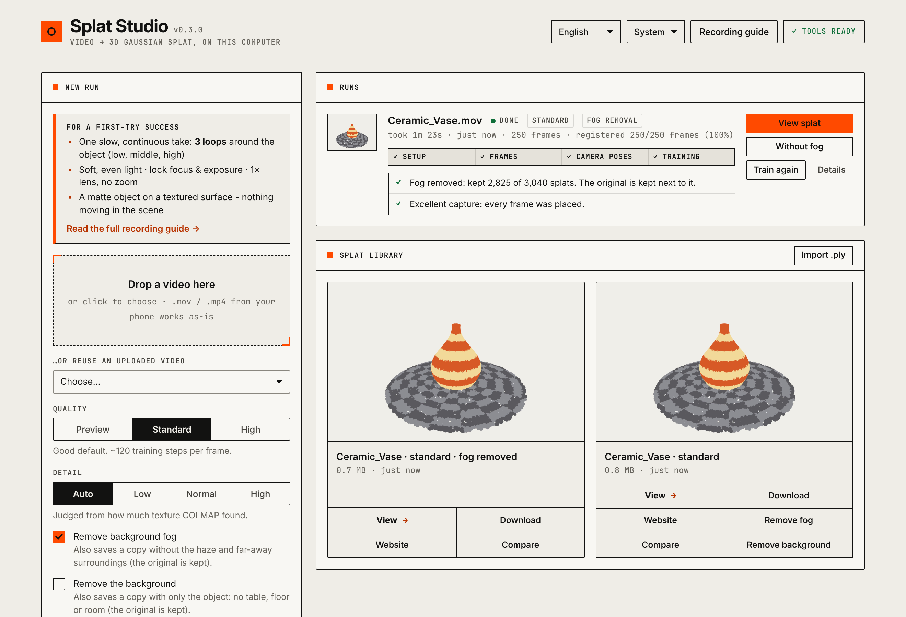
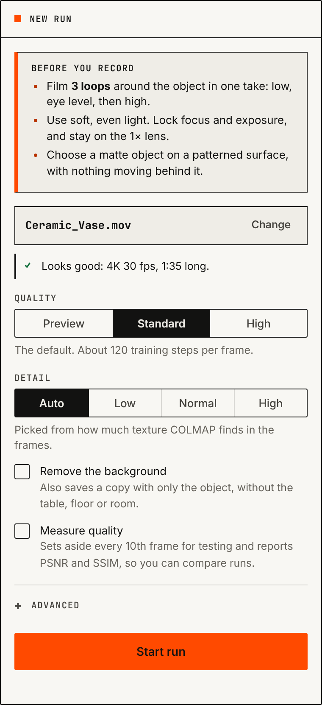
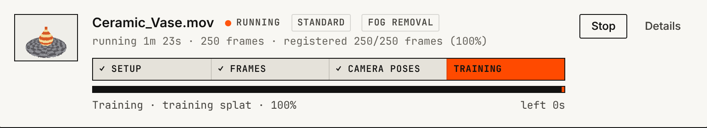
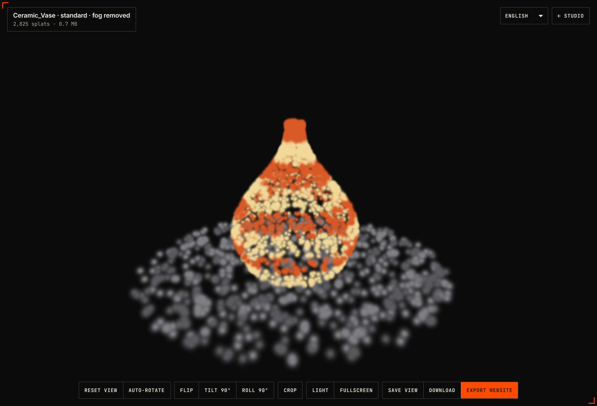
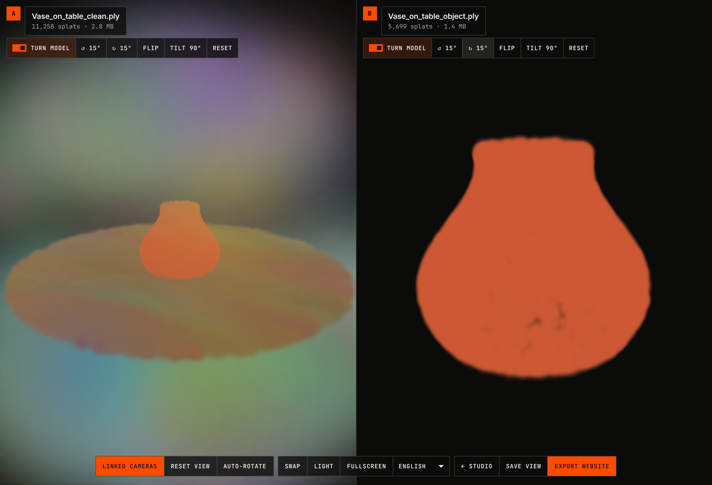

# Splat Studio

**Turn a phone video into a 3D Gaussian splat on your own Mac, then put it on a website.**

*English · [Português](#português)* — the app itself switches between English and Portuguese.

Film an object by walking around it, drop the video into Splat Studio, and get a 3D model
you can orbit, zoom and share. Everything runs locally: no uploads, no accounts, no cloud GPU.



It wires together three open-source tools and handles the fiddly parts for you:

| Step | Tool | What Splat Studio adds |
|---|---|---|
| Video → frames | ffmpeg | even sampling, iPhone HDR conversion, blurry-frame filtering |
| Frames → camera poses | [COLMAP](https://colmap.github.io/) | retries automatically when tracking breaks, time estimates, one folder per run |
| Poses → splat | [Brush](https://github.com/ArthurBrussee/brush) | settings chosen from your footage, built automatically on first use |
| Splat → website | [Spark](https://sparkjs.dev) + three.js | viewer with auto-upright, one-click export of a self-contained site |

## Contents

- [Requirements](#requirements)
- [Install](#install)
- [Quick start](#quick-start)
- [Recording a good video](#recording-a-good-video)
- [Using the app](#using-the-app)
- [Command line](#command-line)
- [Removing background fog](#removing-background-fog)
- [Removing the background](#removing-the-background)
- [Comparing two splats](#comparing-two-splats)
- [Putting a splat on your website](#putting-a-splat-on-your-website)
- [Troubleshooting](#troubleshooting)
- [Development](#development)

## Requirements

- A Mac with Apple Silicon (M1 or newer) is the main target: Brush trains on its GPU through Metal.
  Linux with an NVIDIA GPU should also work, but you install the tools yourself.
- Python 3.9 or newer (the one that comes with macOS is fine).
- About 5 GB of free disk space for the tools, plus room for your videos.

Everything else (Homebrew, ffmpeg, COLMAP, Rust, Brush) is installed by `./splat-studio setup`.

## Install

```bash
git clone https://github.com/gpspelle/splat-studio.git
cd splat-studio
./splat-studio setup
```

`setup` checks what's missing and installs it. It may open a macOS window to install the
Xcode command-line tools, and ask for your Mac password to install Homebrew. Then it downloads
and builds Brush, which takes 10–30 minutes, once. Run `./splat-studio check` at any time to
see what's installed.

> Prefer `pip`? `pip install .` gives you a `splat-studio` command. The `./splat-studio`
> script does the same without installing anything.

## Quick start

```bash
./splat-studio
```

Your browser opens Splat Studio at <http://localhost:8765>. Then:

1. Read the **Recording guide** (in the menu at the top) and film your object.
2. Drop the video onto **New run**. Splat Studio checks it and warns you about anything likely to fail.
3. Click **Start run** and watch the progress: frames → camera poses → training.
4. Click **View splat** to look at the result, and **Export website** to publish it.

Your videos and results are kept in `~/SplatStudio` (change it with `--data-dir`).

## Recording a good video

The quality of the video decides almost everything. In short:

- **One continuous take, three loops** around the object: low, eye level, high. Walk slowly,
  1½–4 minutes in total.
- **Soft, even light.** Lock focus and exposure (press and hold on the object). Stay on the
  1× lens and never zoom.
- **A matte object on a textured surface**, with nothing moving in the scene. Avoid glass,
  chrome, plain white tables and turntables.



The full guide is in the app and in **[docs/capture-guide.md](docs/capture-guide.md)**.

Splat Studio helps you get it right with fewer attempts:

- **Before processing**, it checks each upload's length, resolution, frame rate, HDR and
  orientation, and tells you what to fix.
- **After a run**, if tracking broke, it tells you **at which seconds of the video** it
  happened, so you know exactly which part to re-film.
- It flags blurry footage, and runs that couldn't be reconstructed, with concrete advice.

<br clear="right">

## Using the app

### Runs



Each run shows its stage, the current step, and the time left. Estimates get accurate after
the first run on your Mac, because measured speeds are remembered. Runs are queued and
processed one at a time. **Details** shows each COLMAP attempt, where tracking broke, the Brush
settings used, and the full log.

**Train again** re-trains a finished run with other settings, reusing its camera poses (no
COLMAP). Every splat is kept, so you can compare.

### Look and feel

The app follows your computer's light or dark setting; the **Theme** menu at the top right
overrides it. The design system (colours, type, components, accessibility rules) is described
in [docs/design-system.md](docs/design-system.md).

### Language

Use the language menu at the top right to switch between **English** and **Português**. The
choice is remembered in your browser; the first time, it follows your browser's language.

### Settings

| Setting | Options | Notes |
|---|---|---|
| Quality | Preview · Standard · High | Preview is ~4× faster, good for checking a capture. High takes longer and gives finer detail. |
| Detail | Auto · Low · Normal · High | Auto judges it from how much texture the footage has. |
| Remove the background | on/off (off) | Also saves a copy with only the object: no table, floor or room. The original is always kept. |
| Measure quality | on/off | Holds back every 10th frame and reports PSNR/SSIM, so runs can be compared with a number. |
| Advanced | frames, trim start/end, extra Brush options | e.g. trim the first seconds while you were pressing record. |

### Viewer



Drag to orbit, scroll to zoom, right-drag to pan. The model is stood upright automatically,
using the "up" direction Brush saves in the file, and the camera is framed on the object. If
it's still tilted, use **Flip**, **Tilt** or **Roll**. **Crop** hides everything outside a
sphere around the object (drag the slider to resize it). **Save view** remembers orientation
and crop, and both are included when you export a website. You can also import any `.ply`, `.spz`,
`.splat` or `.ksplat` file into the library.

## Command line

Everything in the app is also available in the terminal:

```bash
./splat-studio run IMG_1234.MOV                        # video -> splat
./splat-studio run IMG_1234.MOV --quality preview      # quick look
./splat-studio run IMG_1234.MOV --start 0:03 --end 1:45
./splat-studio run --train-only workspace/IMG_1234/latest --quality high   # re-train, skip COLMAP
./splat-studio run IMG_1234.MOV -- --sh-degree 1       # anything after -- goes to Brush
./splat-studio run --help
```

Paths are relative to the current folder. Each run lands in `workspace/<video>/run_<date_time>/`:

```
dense/         camera poses + undistorted images (what Brush trains on)
splat/         the trained .ply files
summary.txt    settings, each COLMAP attempt, track breaks, the Brush command, the result
colmap.log     COLMAP's full output
```

You can also run single stages: `./splat-studio frames VIDEO` and `./splat-studio colmap FRAMES_DIR`,
and add `--remove-background` to `run` to also save a copy with only the object. `./splat-studio isolate NAME.ply` does the latter for any splat.

## Removing background fog

Splats of indoor scenes often look foggy: the room around the object was only seen from a
distance and a few angles, so the trainer fills it with large, faint splats. Splat Studio
handles this in three ways:

- **Every run removes the fog.** After training it saves `NAME_clean.ply` next to the original,
  and **View splat** opens that copy (**With fog** opens the original). The object is located
  from where the cameras were pointing. The original file is never changed. For imported
  splats and runs made before this, **Remove fog** in the library does the same.
- **The viewer frames the object**, not the whole cloud, and **Crop** hides the rest.
- **`./splat-studio inspect NAME.ply`** prints numbers that explain the fog, with a diagnosis:

```text
Outside object:  43% of splats   (farthest 5.99 from the centre)
Fog-like:        43% of splats (large, faint, outside the object)
Framing:         whole scene 8.31 across vs object 0.871

Diagnosis:
  - 43% of splats are large and faint, outside the object: background fog. ...
  - The viewer frames everything (8.3 units across) while the object is about 0.87: ...
```

Add `--run workspace/<video>/run_<date_time>` to use the run's camera positions. If the
diagnosis says *most splats are nearly transparent even near the object*, cleaning won't help:
the camera positions were inaccurate. Re-run COLMAP or re-film following the recording guide.

## Removing the background

Fog removal keeps the object *and* what it stands on. To show the object alone, for example on
a product page, use **Remove background** (in the library, or the option on new runs), or
`./splat-studio isolate NAME.ply [--run workspace/<video>/run_<date_time>]`. It saves
`NAME_object.ply` next to the original, which is never changed:

1. It keeps the region around the object, like fog removal.
2. It finds the flat surface the object stands on (table, floor, rug) along the model's "up"
   direction, and drops it together with everything below it.
3. It keeps the connected blob of splats around the object, which drops what's left of the
   room: walls, shelves, other things on the table that don't touch the object.

The object's very bottom edge, where it touches the table, may lose a thin band. If too much
or too little is removed, `--radius 1.3` (or `0.8`) widens or narrows the search region.

This works on the geometry of the trained splat. Removing the background from the video
frames before training (segmentation masks) would give cleaner edges and is planned.

## Comparing two splats



In the library, click **Compare** on two splats, then **Compare 2/2**. They open side by side
(one above the other on a phone). Their cameras are linked: turning or zooming one turns the
other the same way, with each model framed to its own size, so objects of different sizes are
seen alike. **Linked cameras** toggles this (key `L`). **Export website** downloads a
comparison website that works like the single-splat one (`index.html`, `compare-config.json`,
`model_a.ply`, `model_b.ply`, `vendor/`). Orientation and crop saved in the viewer are used.

## Putting a splat on your website

**Export website** (in the viewer or the library) downloads a zip:

```
index.html            the viewer
model.ply             your splat
viewer-config.json    title and orientation
vendor/               three.js + Spark (no CDN needed)
```

Upload the folder to any static host (GitHub Pages, Netlify, Cloudflare Pages, S3, your own
server) and it works as is. Opening `index.html` straight from your disk won't work, because
browsers block that; preview it locally with `python3 -m http.server`.

Large splats load slowly on phones. Keep **Quality** at Standard, or compress the `.ply` with
[SuperSplat](https://superspl.at/editor) (crop away the background, export compressed) before exporting.

## Troubleshooting

| Problem | What to do |
|---|---|
| "Not good enough to train on" | The camera track broke too often. Check the advice on the run: it names the seconds where it broke. Re-film more slowly, in better light, on a textured surface. |
| The model has holes or blurry sides | Those angles weren't filmed, or their frames weren't placed. Add the missing loop (usually the high one). |
| Foggy haze around the model | New runs already remove it. For imported splats use **Remove fog**; **Crop** in the viewer hides what's left. `./splat-studio inspect` explains the cause. See [Removing background fog](#removing-background-fog). |
| The table or room is still around the object | Use **Remove background** (see [Removing the background](#removing-the-background)). |
| Floating specks around the model | Normal for splats. Fog removal takes out most of them; for fine control use [SuperSplat](https://superspl.at/editor). |
| The model is upside down or sideways | **Flip** / **Tilt** / **Roll** in the viewer, then **Save view**. |
| A tool is missing | Click the tools badge (top right) or run `./splat-studio check`, then `./splat-studio setup`. |
| `command not found: colmap` after installing | Open a new terminal, or run `./splat-studio setup` again: it adds Homebrew and Rust to the path. |
| Time left says "measuring speed" or no total | Each step is timed as it runs; the whole-run total appears once your Mac has finished one full run. |

## Development

```bash
python3 -m unittest discover -s tests -t .      # all tests, no extra packages needed
```

Every change must keep the whole suite passing. `tests/integration/test_compat.py` pins what
earlier versions produced (run folders, job records, API fields, exported sites); if a change
breaks it, that's a breaking change and needs a note in [CHANGELOG.md](CHANGELOG.md).

The tests run the real pipeline code with real ffmpeg, plus stand-ins for COLMAP and Brush
that print the real tools' output formats. The fake Brush rejects any option the real Brush
doesn't have. Browser tests run when Playwright is installed.
See **[CONTRIBUTING.md](CONTRIBUTING.md)** and **[docs/how-it-works.md](docs/how-it-works.md)**.

An experimental Docker setup is in [`docker/`](docker/). It's mostly useful on Linux with an
NVIDIA GPU: on a Mac, Docker can't use the Apple GPU.

## Português

O Splat Studio transforma um vídeo de celular em um splat gaussiano 3D no seu próprio Mac e
gera um site para mostrá-lo. A interface está em inglês e português: escolha o idioma no menu
no canto superior direito.

```bash
git clone https://github.com/gpspelle/splat-studio.git
cd splat-studio
./splat-studio setup      # instala o que falta e compila o Brush (uma vez)
./splat-studio            # abre o app no navegador
```

Para gravar bem: **uma gravação contínua com 3 voltas** ao redor do objeto (baixa, média, alta),
andando devagar; luz suave e uniforme; foco e exposição travados; lente 1× sem zoom; objeto fosco
sobre uma superfície com textura. O guia completo está no app (**Guia de gravação**).

Se o modelo ficar com **névoa** ao redor, use **Remover névoa** na biblioteca ou **Recortar** no
visualizador; `./splat-studio inspect ARQUIVO.ply` explica a causa. Para mostrar só o objeto,
sem mesa nem ambiente, use **Remover fundo**. Para ver dois splats lado a lado, clique em
**Comparar** em dois splats da biblioteca: as câmeras andam juntas, e a comparação pode ser
exportada como site.

## Credits

Built on [COLMAP](https://colmap.github.io/), [Brush](https://github.com/ArthurBrussee/brush),
[Spark](https://sparkjs.dev), [three.js](https://threejs.org) and [ffmpeg](https://ffmpeg.org).
Released under the [MIT license](LICENSE).
