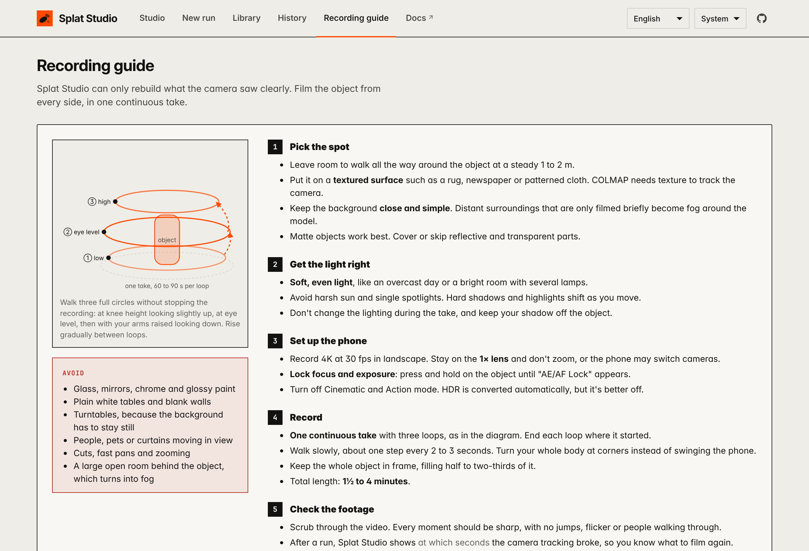

# Recording guide

How to film an object so the reconstruction works on the first try. The same guide is
built into the app (the **Recording guide** button).

The software can only rebuild what the camera saw **clearly**, from **many angles**, in **one
continuous take**. Almost every failed run comes down to breaking one of those three.



## 1. Pick the spot

- Room to walk all the way around the object, a steady 1–2 m from its surface.
- Put it on a **textured surface**: a rug, newspaper, patterned cloth. COLMAP (the step that
  works out where the camera was) tracks texture, and a plain white table gives it nothing.
- **Matte objects work best.** Glass, mirrors, chrome and very glossy paint show reflections
  that move as you walk, which confuses the tracking. Cover or skip those parts.
- Nothing in view should move: no people, pets, curtains or screens.

## 2. Get the light right

- **Soft, even light**: overcast daylight, or a bright room with several lamps.
- Avoid harsh sun or a single spotlight. Hard shadows and highlights shift as you move.
- Don't change the lights during the take, and keep your own shadow off the object.

## 3. Set up the phone

| Setting | Why |
|---|---|
| 4K, 30 fps, landscape | Sharp detail, little motion blur. |
| Stay on the **1× lens**, never zoom | Zooming makes the phone switch between its cameras, but COLMAP assumes one camera for the whole video. |
| **Lock focus and exposure** (press and hold on the object until "AE/AF Lock" appears) | Otherwise the brightness and sharpness drift as you walk around. |
| Cinematic and Action mode **off** | Both crop and distort the image. |
| HDR Video off (Settings → Camera → Record Video) | Optional: HDR is converted automatically, but off gives the most faithful colours. |

## 4. Record: three loops, one take

```
        ③ high   — arms raised, looking down at the top
      ② eye level — straight on
    ① low        — knee height, looking slightly up
```

- Start recording and **don't stop** until you're done.
- Walk one full circle at each height. End each loop where it started, then rise gently
  into the next one. The overlap between loops is what joins them into one model.
- Keep about the same distance from the object's **surface**, not from its centre. Around a
  long object, walk a rounded rectangle rather than a circle.
- Walk **slowly**, about 2–3 seconds per step. At corners, turn your body; don't swing the phone.
- Keep the **whole object in frame**, filling about half to two-thirds of it. If it's too big
  to fit (a car up close), filming part of it is fine as long as you move slowly.
- Total length: **1½–4 minutes**. Splat Studio picks frames evenly from the whole video: 250 up to
  about 2½ minutes, then about 1.75 a second (420 for 4 minutes, at most 600).

**Why one take, and not three separate videos?** Splat Studio follows the camera from each
frame to the next (COLMAP's sequential matching), so one continuous video links every loop to the
others through the moments where you rise from one height to the next. Three separate clips have
no such link: they would have to be joined by comparing every frame of one with every frame of
the others, which is slower, and fails when the views from different heights look too different.
Today each video is its own run, so three clips would give three separate models. If you need a
break, pause between loops while still pointing at the object rather than stopping the recording.

## 5. Check before you leave

Scrub through the video. Every moment should be sharp, with no jumps, flicker, or people
walking through. Re-filming now takes a minute. Coming back later takes much longer.

Send it to the Mac with **AirDrop** (Photos → Share → AirDrop). Sent through a website's upload
button (including Splat Studio opened on the phone), Messages, WhatsApp or Mail, the iPhone shrinks
it, for example to 320×568, and Splat Studio warns that it's a shrunk copy.

## 6. More tips

- **Move smoothly**, as if the phone were on rails: steady speed, no sudden turns. Each frame
  should show most of what the previous one showed.
- **Wipe the lens** first. A fingerprint smear softens every frame.
- Keep windows and bright lamps **behind you**, not behind the object: backlight darkens it and
  causes flare.
- Small objects: raise them on a box under a patterned cloth, so the low loop can look slightly up.
- For details that matter (a logo, a wheel, a face), finish with a slow close pass in the same
  take: move in gradually, then back out. Never jump closer.
- Plain surroundings? Lay a few magazines or a patterned cloth around the object.
- Outdoors, film on an overcast day or in open shade, and be quick: passing clouds change the light.
- Near shiny objects, wear plain, dark clothes: your reflection moves with you.

## 7. Cars and other large objects

- Walk a **rounded rectangle** that follows the body 1.5–2 m from the paint, not a circle around
  the car's centre. Coverage is measured in angles around the car, so the shape of the walk
  doesn't count against you.
- Three loops: crouched at wheel height, at eye level, then as high as you can (arms raised, a
  step stool or a selfie stick) to see the roof.
- Park with about 2 m free all around, away from other cars, on dry asphalt or paving. A side
  against a wall is recognised from the 3D points (it won't stop the run), but it can't be rebuilt.
- Paint, windows and chrome act like mirrors: **overcast light** helps more than anything else.
  Expect the windows to come out hazy.
- Allow 3–5 minutes. The number of frames grows with the video's length on its own (about 420 for
  4 minutes); **Frames** under New run → Advanced sets it by hand.
- The underside can't be filmed and never counts as missing. Wheels need a slow close pass in the
  same take; the interior seen through the windows usually stays soft.

## 8. People

- **Ask first.** A 3D model of someone is personal: get their OK before filming and before sharing it.
- The person has to stay **completely still**. Sitting is far easier than standing; rest the
  hands on the knees or an armrest instead of holding them up.
- Give them a point at eye height to look at, and a relaxed expression they can hold. Blinking is
  fine; moving the eyes or the head isn't.
- Keep it **short**, 45–90 seconds: two loops for someone seated (chest height, then just above
  the head), plus a low loop for a full standing body.
- Move steadily, a little faster than for an object: less time means less movement. Never turn
  the person on a swivel chair (the background must stay still around them).
- Matte, patterned clothes help; plain black, plain white, shiny or sequinned fabric is hard. Take
  off glasses and tie back loose hair: flyaway strands come out blurry.
- Soft light from several sides, so the face has no hard shadows.
- Choose **What to keep → One object** to keep only the person and drop the chair.

## What Splat Studio tells you

- **On upload**, it checks the video's length, resolution, frame rate, HDR and orientation,
  and warns you before you spend time processing.
- **Right after the camera poses**, before training, a coverage ring shows where the cameras were
  around the object. A side you skipped, or filming from only one height, gives a warning with
  the moment in the video. A side nobody filmed stops the run before training, so you can film
  it again rather than wait; **Train anyway** continues with the same camera positions.
- **After a run**, if the camera track broke, it tells you **at which seconds of the video**
  (for example "around 0:42–0:51"). Look at those moments: usually a fast turn, motion blur,
  something passing in front, or the object leaving the frame. Re-film just that more slowly.
- It also flags when many frames were blurry (move slower, add light, lock focus).

## Avoid

- Glass, mirrors, chrome, very shiny paint
- Plain white tables and blank walls around the object
- **Turntables**: the object turns but the background doesn't, which breaks the tracking
- Cuts, pauses followed by fast pans, zooming
- Moving people, pets or curtains in view

A stand, a holder or your hand in the shot is fine if you need it: **Choose what to keep**
(beta) removes it before training. Make sure every part of the object is seen in some frames,
since what the holder covers in every frame can't be recovered.
